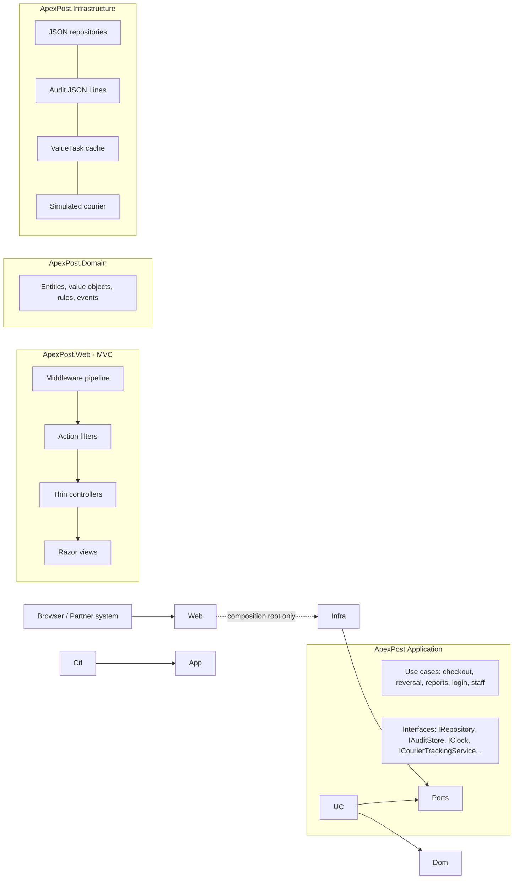

# ApexPost Counter Platform: design

# 1\. Overview


ApexPost Logistics Counter Platform is an ASP.NET Core MVC application for a chain of post-office counters.

A clerk opens a transaction, adds retail goods, shipping and money orders to one basket, and takes payment.

A manager can void or refund, an auditor reads the audit log and reports, and an administrator manages staff

and branches.


The solution has four source projects and two test projects:

\* `ApexPost.Domain`: business rules and value objects, with no knowledge of storage or the web.

\* `ApexPost.Application`: use cases (pricing, tax, transactions, reports) behind interfaces.

\* `ApexPost.Infrastructure`: JSON file storage behind repositories, audit store, seeding.

\* `ApexPost.Web`: controllers, views, middleware, filters, authentication and authorization.

\* `ApexPost.UnitTests` and `ApexPost.IntegrationTests`.


The sections below explain the architecture, the middleware pipeline and its order, how filters differ from

middleware, the main design decisions, and the security and audit design.

## 2\. Architecture



Dependencies point inwards. Domain references nothing. Application references Domain. Infrastructure references
Application. Web references Application and Infrastructure, and only `Program.cs` and `Composition/` touch Infrastructure types.

## 3\. Domain model

```mermaid
classDiagram
    class Branch { +BranchCode Code +Name +Region +OpensAt +ClosesAt +IsActive +Counters }
    class Counter { +Guid Id +Label }
    class Staff { +Guid Id +Name +Email +StaffRole Role +BranchCode HomeBranch +IsActive }
    class Product { +Sku Sku +Name +ProductCategory +Money UnitPrice +TaxCategory }
    class StockItem { +BranchCode +Sku +int Quantity +Add() +Remove() }
    class ShippingZone { +Code +Money BaseRate +Money PerKgRate }
    class CounterTransaction { +Guid Id +BranchCode +ClerkId +Status +PaidWith +Lines +Verification +Total +Open() +Pay() +Void() +Refund() }
    class ILineItem { <<interface>> +Description +Quantity +UnitPrice +TaxCategory +LineTotal }
    class RetailLineItem
    class ShippingLineItem
    class MoneyOrderLineItem
    class IdentityVerification { <<value object>> +DocumentType +MaskedNumber +Result }
    class Money { <<value object>> }
    class Weight { <<value object>> }
    Branch "1" o-- "1..\\\\\\\\\\\\\\\\\\\\\\\\\\\\\\\*" Counter
    CounterTransaction "1" \\\\\\\\\\\\\\\\\\\\\\\\\\\\\\\*-- "\\\\\\\\\\\\\\\\\\\\\\\\\\\\\\\*" ILineItem
    ILineItem <|.. RetailLineItem
    ILineItem <|.. ShippingLineItem
    ILineItem <|.. MoneyOrderLineItem
    CounterTransaction "1" o-- "0..1" IdentityVerification
    Branch "1" -- "\\\\\\\\\\\\\\\\\\\\\\\\\\\\\\\*" StockItem
    Product "1" -- "\\\\\\\\\\\\\\\\\\\\\\\\\\\\\\\*" StockItem
```

**Entities** (identity matters, they change over time): Branch, Counter, Staff, Product, StockItem, ShippingZone, CounterTransaction.
**Value objects** (immutable, equal by value, validate themselves): Money, Weight, Address, BranchCode, Sku, IdentityVerification.

**Mixed basket.** A basket holds `ILineItem`s. Retail goods, shipping and money orders are separate classes
that implement the interface (composition), so the transaction does not care what a line is, and a new service
type is one new class (see ADR-2).

## 4\. Middleware pipeline and order

```mermaid
flowchart TD
    A\\\\\\\\\\\\\\\\\\\\\\\\\\\\\\\[1 CorrelationId] --> B\\\\\\\\\\\\\\\\\\\\\\\\\\\\\\\[2 RequestLogging + timing]
    B --> C\\\\\\\\\\\\\\\\\\\\\\\\\\\\\\\[3 ExceptionHandling - Problem Details]
    C --> D\\\\\\\\\\\\\\\\\\\\\\\\\\\\\\\[4 StatusCodePages - not for /integration]
    D --> E\\\\\\\\\\\\\\\\\\\\\\\\\\\\\\\[5 SecurityHeaders]
    E --> F\\\\\\\\\\\\\\\\\\\\\\\\\\\\\\\[6 HSTS - not Development]
    F --> G\\\\\\\\\\\\\\\\\\\\\\\\\\\\\\\[7 HttpsRedirection]
    G --> H\\\\\\\\\\\\\\\\\\\\\\\\\\\\\\\[8 MaintenanceMode - keeps /health]
    H --> I\\\\\\\\\\\\\\\\\\\\\\\\\\\\\\\[9 StaticFiles]
    I --> J\\\\\\\\\\\\\\\\\\\\\\\\\\\\\\\[10 Routing]
    J --> K\\\\\\\\\\\\\\\\\\\\\\\\\\\\\\\[11 IpRestriction]
    K --> L\\\\\\\\\\\\\\\\\\\\\\\\\\\\\\\[12 CORS]
    L --> M\\\\\\\\\\\\\\\\\\\\\\\\\\\\\\\[13 ApiKey]
    M --> N\\\\\\\\\\\\\\\\\\\\\\\\\\\\\\\[14 RateLimiter]
    N --> O\\\\\\\\\\\\\\\\\\\\\\\\\\\\\\\[15 Authentication]
    O --> P\\\\\\\\\\\\\\\\\\\\\\\\\\\\\\\[16 Authorization]
    P --> Q\\\\\\\\\\\\\\\\\\\\\\\\\\\\\\\[Endpoint: /health or MVC controller]
```



|#|Middleware|Why it sits here|
|-|-|-|
|1|Correlation ID|First, so every later log line, error body and audit entry has the ID.|
|2|Request logging and timing|Outside the exception handler so the response status it logs is the final one, and `finally` times failed requests too.|
|3|Exception handling|Wraps everything that can throw (maintenance, security, MVC). Inside logging, so a 500 is logged with its time.|
|4|Status code pages|Turns empty 403/404 responses into a friendly page. Skipped for `/integration`, which must return JSON.|
|5|Security headers|Uses `OnStarting`, so headers are present on every response including errors and short-circuits (maintenance, 401, 429).|
|6, 7|HSTS, HTTPS redirection|Before any real work; no point serving plain HTTP. HSTS is off in Development so localhost is not pinned to HTTPS.|
|8|Maintenance mode|Cheap 503 before routing, auth and database-like work. `/health` is exempt so monitors still work.|
|9|Static files|Short-circuits css and images before routing, auth and rate limits (they need none of them).|
|10|Routing|Must come before everything that reads endpoint metadata (`\\\\\\\\\\\\\\\\\\\\\\\\\\\\\\\[IpRestricted]`, `\\\\\\\\\\\\\\\\\\\\\\\\\\\\\\\[RequireApiKey]`, CORS, rate limit attributes).|
|11|IP restriction|Cheapest check, and it should reject strangers before any key comparison.|
|12|CORS|Before the API key check so a browser preflight (which cannot carry the key) is answered, not rejected.|
|13|API key|Rejects unknown callers and records the partner name for the rate limiter.|
|14|Rate limiter|After the API key so the limit is per partner; login is limited per client address. Before authentication so password guessing is throttled before any password is checked.|
|15, 16|Authentication, authorization|After routing (policies come from endpoint metadata) and after the cheap checks. The fallback policy requires a signed-in user for every endpoint that does not say `\\\\\\\\\\\\\\\\\\\\\\\\\\\\\\\[AllowAnonymous]`.|

**Forwarded headers and proxies.** The IP allowlist reads `Connection.RemoteIpAddress`. Behind a reverse proxy that is
the proxy's address, so either everyone is blocked or everyone is allowed. The fix is `UseForwardedHeaders` with
`KnownProxies` or `KnownNetworks` set; it must never trust `X-Forwarded-For` from the open internet, because any client can
send that header and pretend to be an allowed address. The app fails closed: an unknown address or an empty list is denied.

**CORS is not a security boundary.** CORS only tells a browser whether page JavaScript from another origin may read the
answer. curl, Postman and other servers ignore it, and the request still arrives. The API key and the IP allowlist protect the
endpoint; CORS only stops other websites from using a visitor's browser to read it. A test shows an unapproved origin still reaches the server and is stopped by the key.

## 5\. Filters versus middleware

|Concern|Where|Why|
|-|-|-|
|Correlation ID, request timing, security headers, maintenance, HTTPS|Middleware|Apply to every request, including static files and non-MVC endpoints; need no MVC knowledge.|
|Exception to Problem Details|Middleware|Must also catch errors thrown outside MVC (routing, other middleware).|
|IP allowlist, API key, rate limiting, CORS, authentication|Middleware|Must reject before MVC runs; use endpoint metadata only.|
|**Audit** (`AuditActionFilter`)|Action filter|Needs the controller and action, the `\\\\\\\\\\\\\\\\\\\\\\\\\\\\\\\[Audit]` marker, route values, the action result type and the time spent in the action; none of that exists in middleware. Runs only for MVC actions.|
|**Validation** (`ValidationFilter`)|Action filter|Needs `ModelState` and the action arguments; the answer depends on the action (redisplay a view, redirect with a message, or JSON).|
|**Performance** (`PerformanceFilter`)|Action filter|Times only the action itself, not routing, static files or the view, and knows which action was slow.|
|**Domain exceptions** (`DomainExceptionFilter`)|Exception filter|A broken business rule on a form should return the user to that page with a message (Post/Redirect/Get), which needs MVC results. Unknown exceptions are left for the middleware.|
|**Branch access** (`BranchAccessFilter`)|Action filter|Reads the `branch` action argument and the user's claims; returns `Forbid`.|

Filter order: audit (-1000) wraps performance (-900) wraps validation (-500), so the audit entry still records requests
rejected by validation, and timing includes validation.

## 6\. Architecture decision records

* ### \### ADR-1: Keep the layers, add a Web project on top
* \* \*\*Problem:\*\* I needed to add a web application, but the business rules should not end up inside controllers.
* \* \*\*Decision:\*\* I kept Domain, Application and Infrastructure and added `ApexPost.Web`. Controllers only call interfaces.
* \* \*\*Why:\*\* the rules stay in one place and are easy to unit test. When storage changes later, only the Infrastructure project changes.
* \* \*\*Week 1 check:\*\* the Week 1 layered architecture survived the change to the ApexPost domain. I redesigned the basket (interface-based line items), added value objects, and added the Web layer.
* \* \*\*Alternative:\*\* one MVC project with everything inside. It is quicker to start, but rules spread into controllers and are hard to test.

### 

* ### \### ADR-2: One basket with different kinds of lines, using an interface
* \* \*\*Problem:\*\* a basket can hold retail goods, shipping and money orders. They share price, quantity and tax, but each has its own data.
* \* \*\*Decision:\*\* I used an `ILineItem` interface with three small classes. The transaction holds a list of `ILineItem`.
* \* \*\*Why:\*\* adding a new kind of line means adding one class and does not change the transaction.
* \* \*\*Alternative:\*\* one big class with many optional fields. That would allow invalid combinations, such as a retail line with a weight.
* ### 
* ### \### ADR-3: Prices and tax come from configuration
* \* \*\*Problem:\*\* shipping rates, service multipliers and tax rates change often.
* \* \*\*Decision:\*\* rates are read from configuration. Tax is passed to the transaction as a function, so the domain does not know any rate.
* \* \*\*Why:\*\* a price change is a settings edit, not a code change. Tests can use different settings on the same classes.
* \* \*\*Alternative:\*\* fixed numbers in code. That would need a new release for every price change.

### 

* ### \### ADR-4: JSON files behind a repository, written safely
* \* \*\*Problem:\*\* data must survive a restart, and the lab does not use a database yet.
* \* \*\*Decision:\*\* one generic `IRepository` with JSON files behind it. A write goes to a temporary file first and then replaces the real file. A lock stops two writes from mixing.
* \* \*\*Why:\*\* a crash in the middle of a write cannot leave a half-written file. When a database is added later, only the repository changes.
* \* \*\*Alternative:\*\* write directly to the real file. A crash or a second writer could corrupt it.

### 

* ### \### ADR-5: Own cookie login with claims and policies
* \* \*\*Problem:\*\* staff have different roles and branches, and each must see only what they are allowed to.
* \* \*\*Decision:\*\* a login creates a secure cookie holding staff ID, role and branch. Policies decide who can open each page. On every request the staff record is checked again.
* \* \*\*Why:\*\* if a manager is deactivated or a role changes, the effect is immediate. Passwords are stored as PBKDF2 hashes, never as plain text, and login errors use one generic message.
* \* \*\*Alternative:\*\* trust the cookie until it expires. A removed employee could keep working.

### 

* ### \### ADR-6: Audit log that cannot hold secrets
* \* \*\*Problem:\*\* every important action must be recorded, but passwords and full document numbers must never appear in the log.
* \* \*\*Decision:\*\* an action filter writes who, what, when, the result and a correlation ID to an append-only store. The log entry has no field for passwords, document numbers or API keys. Only the document type is stored.
* \* \*\*Why:\*\* a developer cannot leak a secret into the log by mistake, because there is nowhere to put it.
* \* \*\*Alternative:\*\* log whole requests and filter later. One missed field would leak data.
* 

### ADR-7: Middleware order (see section 4)

* **Decision:** correlation, logging, exceptions, status pages, headers, transport, maintenance, static files, then routing and the metadata-driven checks, cheapest first, with authentication and authorization last.
* **Consequences:** every rejection (401, 403, 429, 503, 500) carries a correlation ID and security headers. **Risk:** moving a middleware above routing breaks the attribute-based checks silently, so the integration tests cover each rejection path.

### ADR-8: Bounded concurrency and caching

* **Decision:** `SemaphoreSlim` guards (a) every JSON file write, (b) stock changes across use cases (`StockGate`), and (c) courier lookups (`MaxConcurrentLookups`). Zones and products are read through a `ValueTask` cache with a time-to-live and hit/load counters. The courier timeout uses a linked `CancellationTokenSource`; caller cancellation and our own timeout are told apart.
* **Consequences:** stock can never go negative even with two clerks paying at once. `StockGate` is one lock for the whole process: simple and correct for one server, replaced by a database transaction next week.

### ADR-9: DI lifetimes

* **Decision:** singletons for things with state or locks (repositories, catalogues, event hub, audit store, notification sink, courier service, settings); scoped for use cases; middleware receives singletons in its constructor and would take scoped services only as `InvokeAsync` parameters. `ValidateScopes` and `ValidateOnBuild` are on, so capturing a scoped service in a singleton fails at start-up.

## 7\. SOLID mapping

|Principle|Where|
|-|-|
|**S**ingle responsibility|`ShippingPricer` prices, `TaxCalculator` taxes, `WeightLimitRule` limits weight, `AuditActionFilter` audits, one middleware per concern; controllers only translate HTTP.|
|**O**pen/closed|New line item type = new class implementing `ILineItem`; new report filter = new specification; tax rule is a delegate; new middleware needs no change to the others.|
|**L**iskov|Every `ILineItem` can be added, totalled and taxed without the transaction knowing its type; any `IRepository` (JSON, in-memory test double, database) behaves the same.|
|**I**nterface segregation|`IAuditStore` can only append and read; `IProductCatalog`, `IZoneCatalog`, `ICheckoutService`, `IReversalService` are small and role-specific.|
|**D**ependency inversion|Application defines `IRepository`, `IAuditStore`, `IClock`, `ICourierTrackingService`; Infrastructure implements them; `Program.cs` wires them. Unit tests use in-memory fakes.|

## 8\. Where async, Task.WhenAll, SemaphoreSlim and ValueTask are used

|Technique|Where|Problem solved|
|-|-|-|
|async/await + `CancellationToken`|controller to repository, every I/O call|no blocked threads; a closed browser tab cancels the work. No `.Result`, `.Wait()` or `Thread.Sleep`.|
|`Task.WhenAll`|`ReportService.DashboardAsync` builds sales, low stock and alerts together|dashboard time is the slowest query, not the sum.|
|`SemaphoreSlim`|JSON writes, `StockGate`, courier slots|no lost updates, no negative stock, bounded calls to a slow external system.|
|`ValueTask` + cache|`ProductCatalog`, `ZoneCatalog`|a cache hit finishes synchronously and allocates no `Task`; the catalogue is read on almost every request.|
|Timeout vs cancellation|`SimulatedCourierTrackingService`|our timeout becomes `ExternalServiceTimeoutException` (HTTP 504); a caller cancel is not reported as a failure (HTTP 499, no body); a courier failure is HTTP 502.|

\*\*What I measured.\*\* I measured each of these in `ApexPost.UnitTests/Measurements/MeasurementTests.cs`. Storage reads are simulated as slow (50 ms each) so the effect is visible. Numbers vary a little on every run and machine; these are from my lab VM.


| What | Measurement | Reading |

|---|---|---|

| Catalogue cache (`ValueTask`) | 1 load, 1000 hits. Cold lookup 56.43 ms, warm lookup 0.0003 ms | A hit finishes synchronously from memory, about 100,000 times faster than reading the table. The catalogue is read on almost every request, so this matters. |

| `Task.WhenAll` | Three report queries one after another: 253 ms. Started together with `WhenAll`: 121 ms. `DashboardAsync`: 119 ms | The queries are independent, so the total is close to the slowest one instead of the sum. About 2 times faster. |

| `SemaphoreSlim` (courier lookups) | 10 parallel lookups at 150 ms each: limit 1 took 1560 ms, limit 3 took 623 ms, limit 10 took 156 ms | The limit works as designed: with 3 slots the lookups run in about 4 waves. The courier is never hit by more than 3 calls at once, and it still finishes much faster than one at a time. |


These are simulated delays, not production load. They show the shape of the effect, not exact production figures.


## 9\. C# 14 and advanced C# used

|Feature|Where|Why it helps|
|-|-|-|
|Records and value objects|`Money`, `Weight`, `Address`, `BranchCode`, `Sku`, `IdentityVerification`|invalid values cannot exist; equality by value; no primitive obsession.|
|Pattern matching|`ShippingPricer` (tuple and relational patterns), `TaxCalculator`, `WeightLimitRule`, `ProblemMapping`, `AuditActionFilter`|the rule reads like the business statement.|
|**Extension members** (C# 14)|`Money.IsPositive/RoundedForCash/Percent`, basket summary properties on `CounterTransaction`, `ClaimsPrincipal.StaffId/ApexRole`, `HttpContext.CorrelationId`|claims and basket totals are properties, not repeated string lookups.|
|**`field` keyword** (C# 14)|`Staff.Name/Email`, `Address`|validation in the setter without a hand-written backing field.|
|Generics with constraints|`IRepository<T,TId> where T : Entity<TId>`, `CachedCatalog`, `ISpecification<in T>`|one repository and one cache for every table.|
|Delegates|tax rule `Func<ILineItem, Money>`; `PredicateSpecification<T>(Func<T,bool>)`|rules can change without touching the domain.|
|Events|`CounterEvents` (TransactionCompleted, StockLow, MoneyOrderIssued, TransactionVoided) and `NotificationSubscriber`|observers add notifications without the checkout knowing about them.|
|Custom attributes + reflection|`\\\\\\\\\\\\\\\\\\\\\\\\\\\\\\\[NotBlank]`, `\\\\\\\\\\\\\\\\\\\\\\\\\\\\\\\[TextLength]`, `\\\\\\\\\\\\\\\\\\\\\\\\\\\\\\\[PositiveNumber]`, `\\\\\\\\\\\\\\\\\\\\\\\\\\\\\\\[Pattern]` and `AttributeModelValidator`|declarative rules; reflection metadata cached per type in a `ConcurrentDictionary`.|
|async/`Task.WhenAll`/`SemaphoreSlim`/`ValueTask`|section 8||

## 10\. Security and audit

|Threat|Mitigation|
|-|-|
|Password guessing|per-IP rate limit on the login POST (429), PBKDF2 hashing, one generic error, dummy hash for unknown users, every attempt audited|
|Stolen or stale session|HttpOnly + Secure + SameSite=Strict cookie; revalidation of the staff record on every request; 30 minute sliding expiry; sign-out|
|CSRF|antiforgery token required on every unsafe request, plus SameSite=Strict|
|XSS and clickjacking|Razor encoding, CSP without inline script or style, `X-Frame-Options: DENY`, `X-Content-Type-Options: nosniff`, Referrer-Policy|
|Unauthorised partner access|IP allowlist (fail closed) then API key (constant-time compare, key from user-secrets or environment, 500 if missing) then per-partner rate limit|
|Broken access control (clerk voids, clerk reads another branch)|role policies, `SameBranchOnly` policy and `BranchAccessFilter`, domain rules (home branch, manager role), 403 answers that are audited|
|Cross-site reading of partner data|CORS limited to the approved widget origin (not a security boundary, see section 4)|
|Information leakage|Problem Details with a trace ID only; stack traces only in Development; log values stripped of control characters|
|Personal data|document numbers are masked at creation (last 4 only) and never stored, logged or audited; audit entries have no field for secrets; passwords only as hashes|
|Tampering with history|`IAuditStore` has no update or delete; JSON Lines file written with a single gate. **Limit:** a person with file access can still edit the file; next week's database should use append-only permissions or a hash chain|
|Denial of service|rate limits, bounded courier concurrency, courier timeout, maintenance switch|

What is audited: login (success and failure), logout, transaction opened, sale (payment), money order, identity verification
(type and result only), void, refund, stock adjustment, staff create/update/activate/deactivate, branch open/close and every
access-denied response. Stored in `data/audit.jsonl`, readable by auditors and administrators at `/Audit` and `/Audit/Export`.

## 11\. Known limitations

* The JSON repositories rewrite the whole file on each write and hold everything in memory: right for this lab, not for scale.
* `StockGate` and the in-memory rate limiter are per process; with several servers they need a shared store (next weeks).
* The courier service and notifications are simulations.
* Audit integrity depends on file permissions (see section 10).

