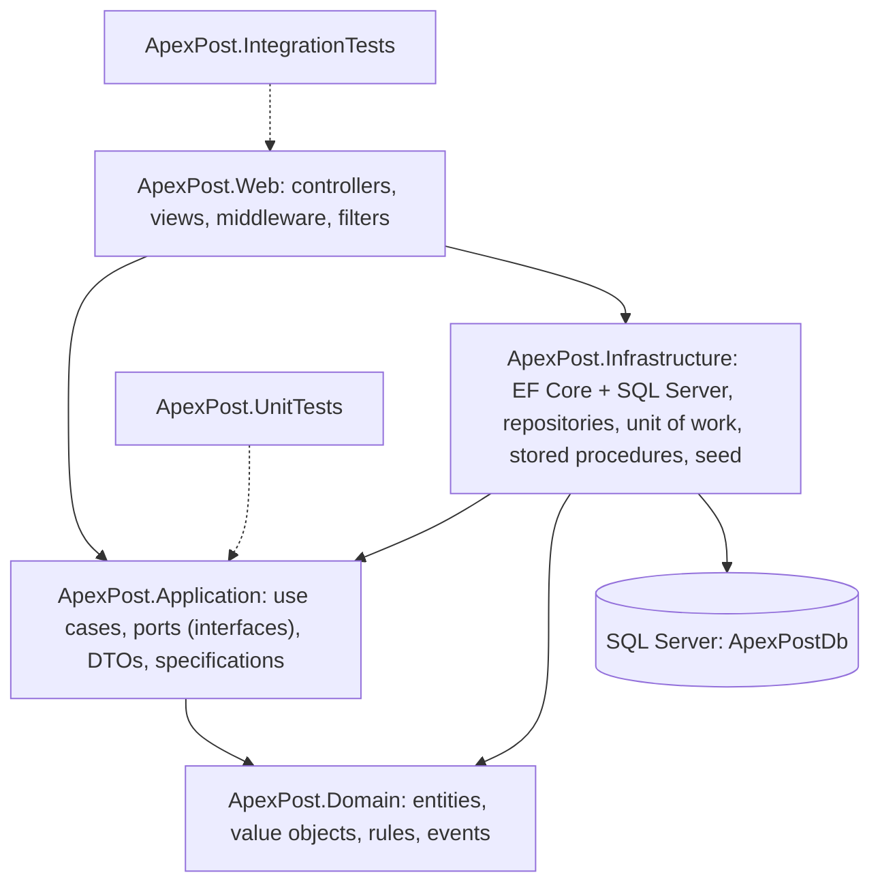
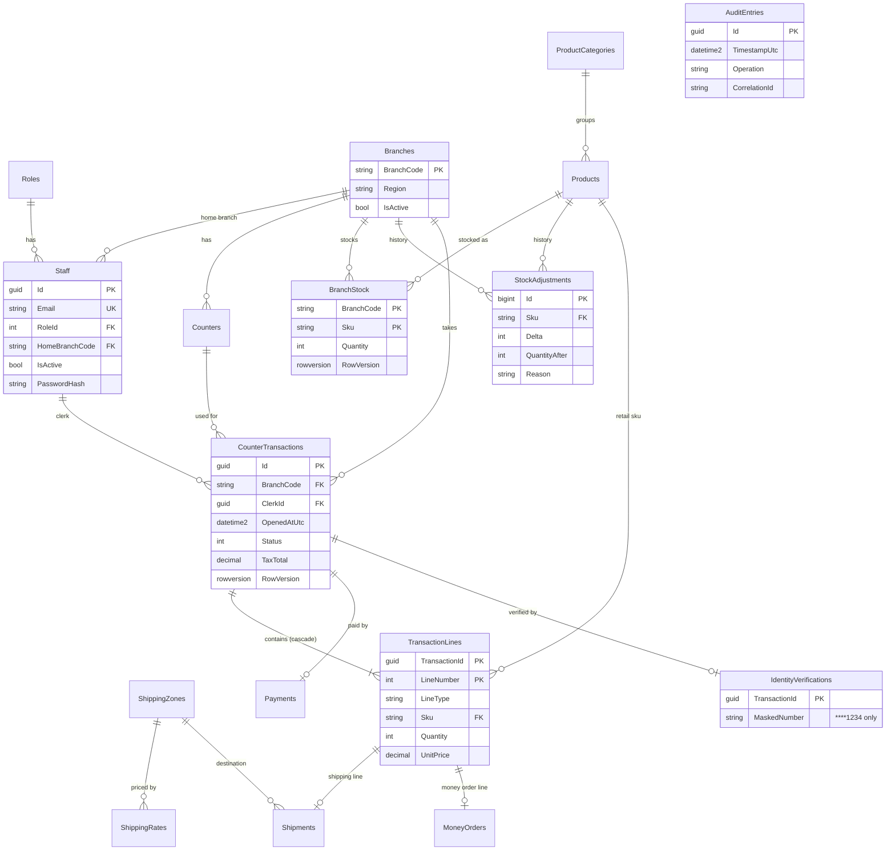
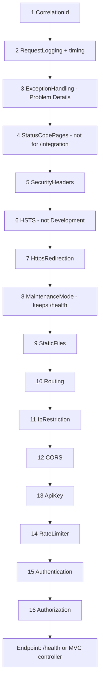

# ApexPost Counter Platform: design

This document describes how the platform is built (Week 3: SQL Server). The Week 2 material (domain model, middleware pipeline,
filters versus middleware, SOLID mapping, security) is kept and updated. The decisions behind the database work are
written as separate records in [docs/adr](docs/adr). Measurements are in [PERFORMANCE.md](PERFORMANCE.md).

## 1. Overview

ApexPost is an ASP.NET Core MVC application (.NET 10, C# 14) for the counters of a postal network: retail sales, parcel and letter
shipping, money orders and identity checks from one counter. The business rules live in the Domain and Application layers and do not
know about the database. Entity Framework Core and SQL Server sit behind the interfaces (`IRepository<,>`, `IUnitOfWork`,
`IAuditStore`, `ICredentialStore`, `IReportService`), so the same use cases run against SQL Server in the web application and against
in-memory fakes in the unit tests.

## 2. Architecture

Dependencies point inwards: Domain depends on nothing, Application depends on Domain, Infrastructure implements the Application
interfaces, and only the composition root (`Composition/ServiceRegistration.cs`) knows which implementation is used.

### 2.1 Persistence design (Week 3)

* **Two models.** The rich domain classes (`Money`, `Sku`, `CounterTransaction`...) stay free of EF attributes. The tables are described by
  small persistence classes (`Persistence/Sql/Entities`) plus fluent configuration (`Persistence/Sql/Configurations`). Mappers convert between
  the two ([ADR-005](docs/adr/ADR-005-domain-and-persistence-models.md)).
* **Value converters** for `Money`, `Sku` and `BranchCode` are registered once with `ConfigureConventions`, so every column and foreign key
  that uses the type is converted the same way.
* **Repositories stage, the unit of work commits.** `AddAsync`, `UpdateAsync` and `DeleteAsync` only change the tracked `DbContext`; the use case ends with
  exactly one `IUnitOfWork.SaveChangesAsync`. A sale (transaction, lines, payment, stock) is therefore one atomic commit
  ([ADR-004](docs/adr/ADR-004-repository-and-unit-of-work.md)). No repository returns `IQueryable`.
* **Commands and queries are separated, in one database.** Commands (`CheckoutService`, `ReversalService`...) load domain aggregates and commit through the unit of work.
  Queries go through query services (`ReportService`, `SqlReportService`, `CatalogueService`). **No separate read database is used**: reads and writes use the same SQL Server database
  (`ApexPostDb`), as the lab allows. The two daily reports (daily branch sales, low stock) and the stock adjustment run as stored procedures
  ([ADR-003](docs/adr/ADR-003-stored-procedures.md)). The other reads (shipping volume, money-order audit, dashboard alerts and the transaction screens) still load aggregates
  through the repositories; moving them to `AsNoTracking` projections is listed under known limitations (section 11).
* **Concurrency.** `BranchStock` and `CounterTransactions` have a `rowversion` column. Two clerks selling the last item at the same moment:
  the second `SaveChanges` raises `DbUpdateConcurrencyException`, `UnitOfWork` translates it to `ConcurrencyConflictException`, and the web layer answers
  HTTP 409 ([ADR-006](docs/adr/ADR-006-concurrency-strategy.md)). A unique index violation becomes `DuplicateValueException` (409) in the same way.
* **Audit.** `AuditActionFilter` writes through `IAuditStore` into the `AuditEntries` table using its own short-lived `DbContext`
  ([ADR-007](docs/adr/ADR-007-audit-store-and-unit-of-work.md)).
* **Shadow audit columns.** Every table has `CreatedAtUtc`, `CreatedBy` and `ModifiedAtUtc`, filled by `ApexPostDbContext.SaveChanges`, so the domain classes do not carry them.

### 2.2 Entity-relationship diagram

Delete behaviour: master data (branches, products, zones, staff) uses `Restrict`, so history cannot be orphaned or silently deleted.
Lines, payment, shipment, money order and identity verification belong to their transaction and use `Cascade`
([ADR-001](docs/adr/ADR-001-schema-and-delete-behaviours.md)). Table checks protect the rules a second time: `Quantity >= 0`, `UnitPrice >= 0`,
`Status IN (1,2,3,4)`, and `MaskedNumber LIKE '****____'` so a full document number can never be stored.

### 2.3 Normalization note (3NF) and the anomalies the design prevents

Every table has a primary key, and every non-key column depends on that key, the whole key and nothing but the key (third normal form):

* `Branches` holds the branch name, region and opening hours. Every other table stores only `BranchCode`.
* `Staff.RoleId` points to `Roles`; the role name is not repeated in `Staff`. `Products.CategoryId` points to `ProductCategories` in the same way.
* Rates belong to the zone (`ShippingRates.ZoneCode`), and a `Shipment` stores only its `DestinationZone`, never a rate.
* `TransactionLines` has the composite key `(TransactionId, LineNumber)`, and `MoneyOrders` and `Shipments` extend a line with the same key, so one line has at most one money order or shipment.

Three anomalies this prevents:

1. **Update anomaly.** If the region of a branch (or the name of a product, or a staff member's role name) were copied into every transaction, a change would have to be made in thousands of rows, and a missed row would give two different regions for one branch.
   Here the value is stored once, so one `UPDATE` changes it everywhere, and the "top products per region" report always sees one region per branch.
2. **Insertion anomaly.** A new branch, product or shipping zone can be created before it has any transaction, stock row or shipment, because master data lives in its own tables.
   In a single wide "sales" table a product could not be recorded until it had been sold at least once.
3. **Deletion anomaly.** Removing the last transaction of a branch (or the last sale of a product) does not remove the branch or product, because they are separate rows.
   The delete rules go further: master data uses `Restrict`, so a branch, product or zone with history cannot be deleted by mistake, while a transaction's own lines, payment, shipment, money order and verification use `Cascade` and disappear together with it
   ([ADR-001](docs/adr/ADR-001-schema-and-delete-behaviours.md)).

**Deliberate copies (not anomalies).** `TransactionLines.UnitPrice` and `TaxCategory` copy the product's price and tax category at the moment of sale, and `CounterTransactions.TaxTotal` stores the tax that was charged.
These are historical facts: if a product's price changes tomorrow, yesterday's receipt must not change. They are stored on purpose, not by accident.

## 3. Domain model

```mermaid
classDiagram
    class Branch { +BranchCode Code +Name +Region +OpensAt +ClosesAt +IsActive +Counters }
    class Counter { +Guid Id +Label }
    class Staff { +Guid Id +Name +Email +StaffRole Role +BranchCode HomeBranch +IsActive }
    class Product { +Sku Sku +Name +ProductCategory +Money UnitPrice +TaxCategory }
    class StockItem { +BranchCode +Sku +int Quantity +Add() +Remove() }
    class ShippingZone { +Code +Money BaseRate +Money PerKgRate }
    class CounterTransaction { +Guid Id +BranchCode +ClerkId +Status +PaidWith +Lines +Verification +Total +Open() +Pay() +Void() +Refund() }
    class ILineItem { <<interface>> +Description +Quantity +UnitPrice +TaxCategory +LineTotal }
    class RetailLineItem
    class ShippingLineItem
    class MoneyOrderLineItem
    class IdentityVerification { <<value object>> +DocumentType +MaskedNumber +Result }
    class Money { <<value object>> }
    class Weight { <<value object>> }
    Branch "1" o-- "1..*" Counter
    CounterTransaction "1" *-- "*" ILineItem
    ILineItem <|.. RetailLineItem
    ILineItem <|.. ShippingLineItem
    ILineItem <|.. MoneyOrderLineItem
    CounterTransaction "1" o-- "0..1" IdentityVerification
    Branch "1" -- "*" StockItem
    Product "1" -- "*" StockItem
```

**Entities** (identity matters, they change over time): Branch, Counter, Staff, Product, StockItem, ShippingZone, CounterTransaction.
**Value objects** (immutable, equal by value, validate themselves): Money, Weight, Address, BranchCode, Sku, IdentityVerification.

**Mixed basket.** A basket holds `ILineItem`s. Retail goods, shipping and money orders are separate classes
that implement the interface (composition), so the transaction does not care what a line is, and a new service
type is one new class (see ADR-2).

## 4. Middleware pipeline and order

|#|Middleware|Why it sits here|
|-|-|-|
|1|Correlation ID|First, so every later log line, error body and audit entry has the ID.|
|2|Request logging and timing|Outside the exception handler so the response status it logs is the final one, and `finally` times failed requests too.|
|3|Exception handling|Wraps everything that can throw (maintenance, security, MVC). Inside logging, so a 500 is logged with its time.|
|4|Status code pages|Turns empty 403/404 responses into a friendly page. Skipped for `/integration`, which must return JSON.|
|5|Security headers|Uses `OnStarting`, so headers are present on every response including errors and short-circuits (maintenance, 401, 429).|
|6, 7|HSTS, HTTPS redirection|Before any real work; no point serving plain HTTP. HSTS is off in Development so localhost is not pinned to HTTPS.|
|8|Maintenance mode|Cheap 503 before routing, auth and database-like work. `/health` is exempt so monitors still work.|
|9|Static files|Short-circuits css and images before routing, auth and rate limits (they need none of them).|
|10|Routing|Must come before everything that reads endpoint metadata (`[IpRestricted]`, `[RequireApiKey]`, CORS, rate limit attributes).|
|11|IP restriction|Cheapest check, and it should reject strangers before any key comparison.|
|12|CORS|Before the API key check so a browser preflight (which cannot carry the key) is answered, not rejected.|
|13|API key|Rejects unknown callers and records the partner name for the rate limiter.|
|14|Rate limiter|After the API key so the limit is per partner; login is limited per client address. Before authentication so password guessing is throttled before any password is checked.|
|15, 16|Authentication, authorization|After routing (policies come from endpoint metadata) and after the cheap checks. The fallback policy requires a signed-in user for every endpoint that does not say `[AllowAnonymous]`.|

**Forwarded headers and proxies.** The IP allowlist reads `Connection.RemoteIpAddress`. Behind a reverse proxy that is
the proxy's address, so either everyone is blocked or everyone is allowed. The fix is `UseForwardedHeaders` with
`KnownProxies` or `KnownNetworks` set; it must never trust `X-Forwarded-For` from the open internet, because any client can
send that header and pretend to be an allowed address. The app fails closed: an unknown address or an empty list is denied.

**CORS is not a security boundary.** CORS only tells a browser whether page JavaScript from another origin may read the
answer. curl, Postman and other servers ignore it, and the request still arrives. The API key and the IP allowlist protect the
endpoint; CORS only stops other websites from using a visitor's browser to read it. A test shows an unapproved origin still reaches the server and is stopped by the key.

## 5. Filters versus middleware

|Concern|Where|Why|
|-|-|-|
|Correlation ID, request timing, security headers, maintenance, HTTPS|Middleware|Apply to every request, including static files and non-MVC endpoints; need no MVC knowledge.|
|Exception to Problem Details|Middleware|Must also catch errors thrown outside MVC (routing, other middleware).|
|IP allowlist, API key, rate limiting, CORS, authentication|Middleware|Must reject before MVC runs; use endpoint metadata only.|
|**Audit** (`AuditActionFilter`)|Action filter|Needs the controller and action, the `[Audit]` marker, route values, the action result type and the time spent in the action; none of that exists in middleware. Runs only for MVC actions.|
|**Validation** (`ValidationFilter`)|Action filter|Needs `ModelState` and the action arguments; the answer depends on the action (redisplay a view, redirect with a message, or JSON).|
|**Performance** (`PerformanceFilter`)|Action filter|Times only the action itself, not routing, static files or the view, and knows which action was slow.|
|**Domain exceptions** (`DomainExceptionFilter`)|Exception filter|A broken business rule on a form should return the user to that page with a message (Post/Redirect/Get), which needs MVC results. Unknown exceptions are left for the middleware.|
|**Branch access** (`BranchAccessFilter`)|Action filter|Reads the `branch` action argument and the user's claims; returns `Forbid`.|

Filter order: audit (-1000) wraps performance (-900) wraps validation (-500), so the audit entry still records requests
rejected by validation, and timing includes validation.

## 6. Architecture decision records

|ADR|Decision|
|-|-|
|[ADR-001](docs/adr/ADR-001-schema-and-delete-behaviours.md)|Table design, keys, check constraints and delete behaviours|
|[ADR-002](docs/adr/ADR-002-index-choices.md)|Which indexes exist and why|
|[ADR-003](docs/adr/ADR-003-stored-procedures.md)|Three stored procedures, called with parameters, and the least-privilege model|
|[ADR-004](docs/adr/ADR-004-repository-and-unit-of-work.md)|Repositories stage, one unit of work commits|
|[ADR-005](docs/adr/ADR-005-domain-and-persistence-models.md)|Separate domain and persistence models with mappers|
|[ADR-006](docs/adr/ADR-006-concurrency-strategy.md)|Optimistic concurrency with rowversion and HTTP 409|
|[ADR-007](docs/adr/ADR-007-audit-store-and-unit-of-work.md)|Audit store uses its own DbContext, not the shared unit of work|
|[ADR-008](docs/adr/ADR-008-exception-translation-and-problem-details.md)|Database errors are translated once, then mapped to Problem Details|
|[ADR-009](docs/adr/ADR-009-secrets-and-connection-string.md)|Connection string and secrets|

Week 2 decisions (middleware order, bounded concurrency and caching, DI lifetimes) are described in sections 4, 5 and 8.

## 7. SOLID mapping

|Principle|Where|
|-|-|
|**S**ingle responsibility|`ShippingPricer` prices, `TaxCalculator` taxes, `WeightLimitRule` limits weight, `AuditActionFilter` audits, `UnitOfWork` only commits and translates database errors, `ProductPriceWriter` only writes prices; one middleware per concern; controllers only translate HTTP.|
|**O**pen/closed|New line item type = new class implementing `ILineItem`; new report = new specification or procedure; `SqlReportService` and `SqlCatalogueService` extend the base services by overriding one method each, without changing the rules in the base class.|
|**L**iskov|Every `ILineItem` can be added, totalled and taxed without the transaction knowing its type. `SqlReportService` can replace `ReportService` anywhere (an integration test checks that both give the same numbers). Any `IRepository` (SQL, in-memory fake) behaves the same.|
|**I**nterface segregation|`IAuditStore` can only append and read; `IProductPriceWriter` has one method; `IProductCatalog`, `IZoneCatalog`, `ICheckoutService`, `IReversalService` are small and role-specific.|
|**D**ependency inversion|Application defines `IRepository`, `IUnitOfWork`, `IAuditStore`, `IClock`, `IProductPriceWriter`; Infrastructure implements them with EF Core; `ServiceRegistration` wires them. Unit tests use in-memory fakes and a spy unit of work.|

## 8. Where async, Task.WhenAll, SemaphoreSlim and ValueTask are used

|Technique|Where|Problem solved|
|-|-|-|
|async/await + `CancellationToken`|controller to repository, every I/O call|no blocked threads; a closed browser tab cancels the work. No `.Result`, `.Wait()` or `Thread.Sleep`.|
|`Task.WhenAll`|Independent I/O against different resources (the simulated storage and courier measurements below). **Not** used for the dashboard any more: with SQL Server all repositories share one scoped `DbContext`, which allows only one operation at a time (running three queries together threw `InvalidOperationException: A second operation was started on this context instance`). `DashboardAsync` now awaits its three queries one after another; the two heavy ones are stored procedures, so each is fast.|
|`SemaphoreSlim`|`StockGate` (in-process stock guard), courier slots|bounded calls to a slow external system and a first line of defence against negative stock. The database is the final guard: `rowversion` and the `Quantity >= 0` check constraint.|
|`ValueTask` + cache|`ProductCatalog`, `ZoneCatalog`|a cache hit finishes synchronously and allocates no `Task`; the catalogue is read on almost every request.|
|Timeout vs cancellation|`SimulatedCourierTrackingService`|our timeout becomes `ExternalServiceTimeoutException` (HTTP 504); a caller cancel is not reported as a failure (HTTP 499, no body); a courier failure is HTTP 502.|

**What I measured.** I measured each of these in `ApexPost.UnitTests/Measurements/MeasurementTests.cs`. Storage reads are simulated as slow (50 ms each) so the effect is visible. Numbers vary a little on every run and machine; these are from my lab VM.

| What | Measurement | Reading |
|---|---|---|
| Catalogue cache (`ValueTask`) | 1 load, 1000 hits. Cold lookup 56.43 ms, warm lookup 0.0003 ms | A hit finishes synchronously from memory, about 100,000 times faster than reading the table. The catalogue is read on almost every request, so this matters. |
| `Task.WhenAll` (simulated independent stores, Week 2) | Three report queries one after another: 253 ms. Started together with `WhenAll`: 121 ms | With independent resources the total is close to the slowest one instead of the sum. This is not possible on one EF Core `DbContext`, which is why the real dashboard is sequential. |
| `SemaphoreSlim` (courier lookups) | 10 parallel lookups at 150 ms each: limit 1 took 1560 ms, limit 3 took 623 ms, limit 10 took 156 ms | The limit works as designed: with 3 slots the lookups run in about 4 waves. The courier is never hit by more than 3 calls at once, and it still finishes much faster than one at a time. |

These are simulated delays, not production load. They show the shape of the effect, not exact production figures.

## 9. C# 14 and advanced C# used

|Feature|Where|Why it helps|
|-|-|-|
|Records and value objects|`Money`, `Weight`, `Address`, `BranchCode`, `Sku`, `IdentityVerification`|invalid values cannot exist; equality by value; no primitive obsession.|
|Pattern matching|`ShippingPricer` (tuple and relational patterns), `TaxCalculator`, `WeightLimitRule`, `ProblemMapping`, `AuditActionFilter`|the rule reads like the business statement.|
|**Extension members** (C# 14)|`Money.IsPositive/RoundedForCash/Percent`, basket summary properties on `CounterTransaction`, `ClaimsPrincipal.StaffId/ApexRole`, `HttpContext.CorrelationId`|claims and basket totals are properties, not repeated string lookups.|
|**`field` keyword** (C# 14)|`Staff.Name/Email`, `Address`|validation in the setter without a hand-written backing field.|
|Generics with constraints|`IRepository<T,TId> where T : Entity<TId>`, `CachedCatalog`, `ISpecification<in T>`|one repository and one cache for every table.|
|Delegates|tax rule `Func<ILineItem, Money>`; `PredicateSpecification<T>(Func<T,bool>)`|rules can change without touching the domain.|
|Events|`CounterEvents` (TransactionCompleted, StockLow, MoneyOrderIssued, TransactionVoided) and `NotificationSubscriber`|observers add notifications without the checkout knowing about them.|
|Custom attributes + reflection|`[NotBlank]`, `[TextLength]`, `[PositiveNumber]`, `[Pattern]` and `AttributeModelValidator`|declarative rules; reflection metadata cached per type in a `ConcurrentDictionary`.|
|async/`Task.WhenAll`/`SemaphoreSlim`/`ValueTask`|section 8||

## 10. Security and audit

|Threat|Mitigation|
|-|-|
|Password guessing|per-IP rate limit on the login POST (429), PBKDF2 hashing, one generic error, dummy hash for unknown users, every attempt audited|
|Stolen or stale session|HttpOnly + Secure + SameSite=Strict cookie; revalidation of the staff record on every request; 30 minute sliding expiry; sign-out|
|CSRF|antiforgery token required on every unsafe request, plus SameSite=Strict|
|XSS and clickjacking|Razor encoding, CSP without inline script or style, `X-Frame-Options: DENY`, `X-Content-Type-Options: nosniff`, Referrer-Policy|
|Unauthorised partner access|IP allowlist (fail closed) then API key (constant-time compare, key from user-secrets or environment, 500 if missing) then per-partner rate limit|
|Broken access control (clerk voids, clerk reads another branch)|role policies, `SameBranchOnly` policy and `BranchAccessFilter`, domain rules (home branch, manager role), 403 answers that are audited|
|Cross-site reading of partner data|CORS limited to the approved widget origin (not a security boundary, see section 4)|
|Information leakage|Problem Details with a trace ID only; stack traces only in Development; log values stripped of control characters|
|Personal data|document numbers are masked at creation (last 4 only, `****1234`) and never stored, logged or audited; a table check constraint rejects anything else; audit entries have no field for secrets; passwords only as hashes|
|Tampering with history|`IAuditStore` has no update or delete. In SQL Server the application login can be given INSERT and SELECT on `AuditEntries` only (see `sql/11_least_privilege.sql`). **Limit:** a database administrator can still change rows; a hash chain or append-only storage would close that|
|Denial of service|rate limits, bounded courier concurrency, courier timeout, maintenance switch|

What is audited: login (success and failure), logout, transaction opened, sale (payment), money order, identity verification
(type and result only), void, refund, stock adjustment, staff create/update/activate/deactivate, branch open/close and every
access-denied response. Stored in the `AuditEntries` table, readable by auditors and administrators at `/Audit` and `/Audit/Export`.

Identity verification is a simulated service (`IIdentityVerificationService`). The clerk supplies only the document; the system decides the result. A real provider would replace the simulated class without changing the domain rule.

|SQL injection|every value reaches SQL Server as a parameter: LINQ queries, `FromSql`/`SqlQuery`/`ExecuteSqlAsync` with interpolated values (EF Core turns each hole into a `SqlParameter`), and stored procedures. There is no string concatenation into SQL text.|
|Over-posting|MVC actions bind to small view models, never to entities. An integration test posts extra fields (`Id`, `IsActive`, `PasswordHash`) and shows they are ignored.|
|Database privileges|see [ADR-003](docs/adr/ADR-003-stored-procedures.md) and `sql/11_least_privilege.sql`: reports can run with EXECUTE on the procedures and no table rights.|

## 11. Known limitations

* `StockGate` and the in-memory rate limiter are per process; with several servers they need a shared store.
* The product catalogue cache is per process too. After a price revision, other servers would show old prices until their cache expires.
* `ReportService.DailySalesAsync` in the base class still loads the day's transactions; the web application uses the stored procedure instead.
* The courier service and notifications are simulations.
* Audit integrity depends on database permissions (see section 10).
* LocalDB is used for development and tests; a production SQL Server needs its own backup, login and role set-up (`sql/11_least_privilege.sql` is the starting point).
* Shipping volume, the money-order audit, the dashboard alerts and the transaction screens still load domain aggregates through `ListAsync(spec)` and filter in C#; they are correct, but they do not scale to the
  200 000-row volume used in `PERFORMANCE.md`. The next step is `AsNoTracking` projections into DTOs or stored procedures, like the two daily reports.