# Performance evidence (Part C)

Rule of this document: **every number and every plan comes from my own SSMS run** on the machine described in section 1. Where something was not measured, the text says so.

Database: `ApexPostDb` on `(localdb)\MSSQLLocalDB`. Scripts: [sql/08_performance_workloads.sql](sql/08_performance_workloads.sql) (the workloads),
[sql/09_perf_load_data.sql](sql/09_perf_load_data.sql) (extra data), [sql/10_perf_cleanup.sql](sql/10_perf_cleanup.sql) (removes the extra data).
Screenshots are in [docs/performance](docs/performance/) and are embedded below under each table.

## 1. How the data was prepared

| Item | Value |
|---|---|
| Seeded transactions (app seeder) | 240 |
| Extra rows added by script 09 (tag `CreatedBy = 'perf-load'`) | 200 000 transactions, 300 000 transaction lines, 100 000 audit rows |
| Skew (transactions per branch after the load) | BR001 146 716, BR002 13 382, BR004 13 381, BR006 13 333, BR003 6 715, BR005 6 714 |
| Machine | Virtual machine (Hypervisor) running Windows 10 Pro, build 22000 (CPU model, RAM and disk type were not recorded) |
| SQL Server version | Microsoft SQL Server 2025 Express (RTM-CU3, KB5077896) 17.0.4025.3 (X64), Feb 25 2026 build; database on `(localdb)\MSSQLLocalDB` |

Why extra data: 240 transactions fit in a few pages, so every plan is fast and an index makes no visible difference.

## 2. Method

For each workload: (1) run with **Include Actual Execution Plan** (Ctrl+M) and `SET STATISTICS IO, TIME ON`, **before** the index migration;
(2) apply the index migration (section 4); (3) run the same statement again. Run each statement twice and note the second run
(the first run reads the pages from disk into memory). Record logical reads (not physical reads) and the CPU/elapsed time from the Messages tab.

## 3. Workloads: before and after

All numbers are from the second run of each statement (warm cache, physical reads 0), measured in SSMS with `SET STATISTICS IO, TIME ON`.
"Reads" means logical reads. Screenshots are in `docs/performance/`.

| # | Workload (query in script 08) | Plan before | Reads before | CPU / elapsed before | Index added | Plan after | Reads after | CPU / elapsed after |
|---|---|---|---|---|---|---|---|---|
| 1 | Newest 20 transactions of BR001 (app: `RecentForBranchAsync`) | Clustered Index Scan (27 %) + Top N Sort (73 %), `w1-before.png` | 5 410 | 94 ms / 147 ms | `CounterTransactions (BranchCode, OpenedAtUtc DESC)` INCLUDE (Status, TaxTotal) | Index Seek + Top, no Sort, `w1-after.png` | **3** | 0 ms / 3 ms |
| 2 | One day of sales for BR001 (range predicate) | Clustered Index Scan on both tables, `w2-before.png` | 13 584 (TransactionLines 8 174 + CounterTransactions 5 410) | 156 ms / 186 ms | `CounterTransactions (BranchCode, Status, OpenedAtUtc)` INCLUDE (TaxTotal) | Hash Match + Eager Spool, `w2-after.png` | **5 259** (TransactionLines 2 210 + Worktable 3 039 + CounterTransactions 10) | 94 ms / 123 ms |
| 3 | Top 10 products by revenue | Clustered Index Scan 74 % (300 241 rows) + Hash Match Aggregate, `w3-before.png` | 8 174 | 250 ms / 303 ms | `TransactionLines (LineType, Sku)` INCLUDE (Quantity, UnitPrice) | Index Seek + Stream Aggregate, `w3-after.png` | **2 210** | 140 ms / 153 ms |
| 4 | Latest 50 audit entries | Clustered Index Scan 22 % (100 015 rows) + Top N Sort 78 %, `w4-before.png` | 2 841 | 63 ms / 130 ms | `AuditEntries (TimestampUtc DESC)` | Index Scan in index order + Top + Nested Loops, `w4-after.png` | **165** | 0 ms / 17 ms |

Plans before and after (screenshots of the actual execution plans):


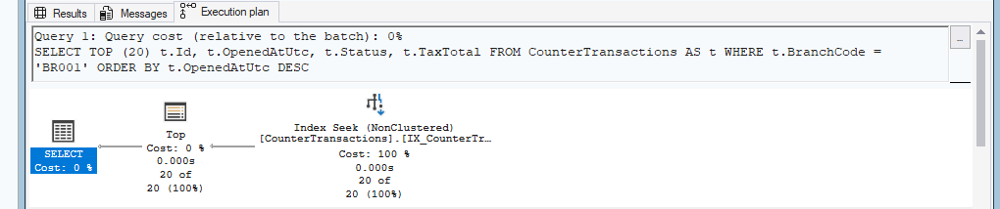
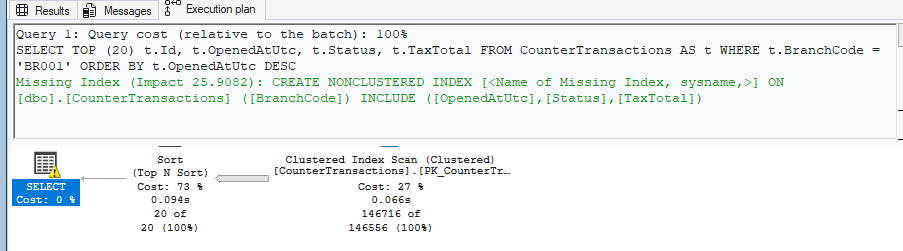
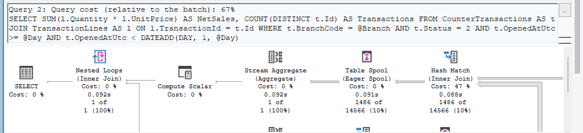
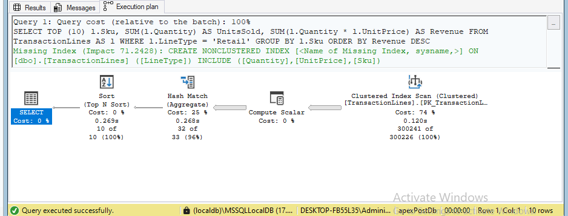
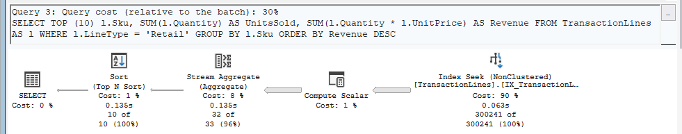
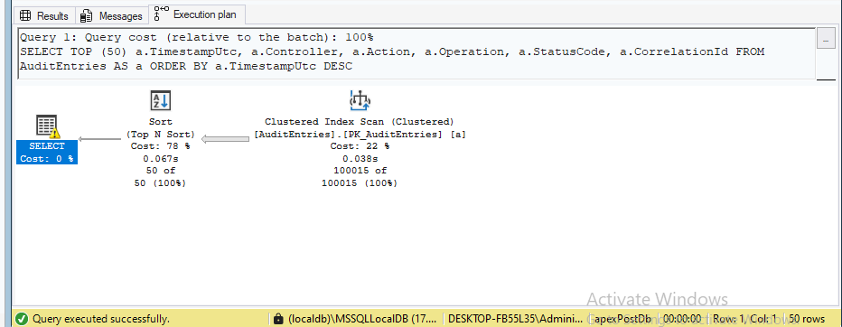
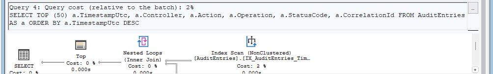

What the plans show:

* **Workload 1.** Before, SQL Server read the whole table, because BR001 owns about 70 % of the rows, so the single-column branch index was not worth using. It then sorted 146 716 rows to keep 20 (the Sort was 73 % of the cost).
  The new index is ordered by branch and then newest first, so the 20 rows are the first 20 entries of the index: a seek, no Sort, 3 page reads instead of 5 410. SQL Server's own missing-index hint (impact 25.9) pointed at the same table; our index also puts `OpenedAtUtc` in the key, which is what removes the Sort.
* **Workload 2.** The reads on `CounterTransactions` fell from 5 410 to 10, and `TransactionLines` from 8 174 to 2 210. The total did not fall as far as in the other workloads, because the plan joins the two tables with a Hash Match and an Eager Spool, and the spool's worktable reads 3 039 pages.
  The index made one side of the join cheap; the join itself is the remaining cost. A different join strategy or a covering index on `TransactionLines (TransactionId)` INCLUDE (Quantity, UnitPrice) could be tried next. This was not tested, so it is only a hypothesis.
* **Workload 3.** The covering index replaces the scan of the full table (8 174 reads) with an index range for `LineType = 'Retail'` that is already sorted by SKU. SQL Server can therefore use a Stream Aggregate instead of a Hash Match Aggregate. Reads dropped to 2 210 (about 3.7 times fewer).
* **Workload 4.** The index is ordered by `TimestampUtc DESC`, so the first 50 entries are read directly (165 reads, mostly the lookups into the clustered index for the columns that are not in the index). The Sort is gone.

## 4. The index migration that was applied

Migration `AddReportingIndexes` (reviewed before applying; it only changes indexes). The idempotent script is regenerated in [database/migrations-idempotent.sql](database/migrations-idempotent.sql).

* Dropped: `IX_CounterTransactions_BranchCode` (replaced by the composite index below).
* `CounterTransactions (BranchCode, OpenedAtUtc DESC)` INCLUDE (`Status`, `TaxTotal`): newest rows of a branch (workload 1).
* `CounterTransactions (BranchCode, Status, OpenedAtUtc)` INCLUDE (`TaxTotal`): one day of sales (workload 2).
* `TransactionLines (LineType, Sku)` INCLUDE (`Quantity`, `UnitPrice`): top products (workload 3).
* `AuditEntries (TimestampUtc DESC)`: latest audit entries (workload 4).

Key order: equality column first (`BranchCode`), then the range or sort column (`OpenedAtUtc`), so a seek lands on the branch and reads the rows already in order. The INCLUDE columns make each index covering for its query, so no key lookups are needed.

## 5. A non-SARGable predicate and its fix

Script 08, section "NON-SARGable", plus one extra variant (A2). All three return the same count (1 059 transactions of BR001 on one day). Reads are from the "after" state, with the new indexes in place.

| | A: `CONVERT(date, col) = @Day` | A2: `YEAR(col)=.. AND MONTH(col)=.. AND DAY(col)=..` | B: `col >= @Day AND col < DATEADD(DAY,1,@Day)` |
|---|---|---|---|
| Logical reads, before the index migration | 5 410 | not measured | 5 410 |
| Logical reads, after the index migration | 17 | **955** | **10** |
| CPU / elapsed after | 0 ms / 16 ms | 31 ms / 57 ms | 16 ms / 68 ms |
| Estimated vs actual rows | **1 vs 1 059 (105 900 %)** | 1 191 vs 1 059 | 13 528 vs 1 059 before the index (see `sargable-b-before.png`) |
| Plan | Constant Scan + Nested Loops (a seek on a range that SQL Server derived itself), `sargable-a-after.png` | Index Seek on `BranchCode` only, then the functions are applied to every BR001 row as a residual filter, `sargable-a2-after.png` | Index Seek on `(BranchCode, OpenedAtUtc)` range, `sargable-b-after.png` |

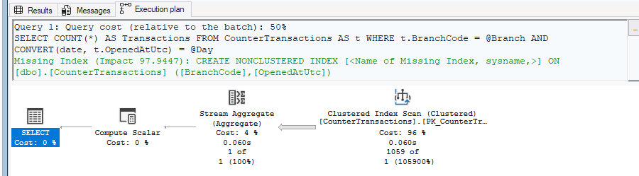

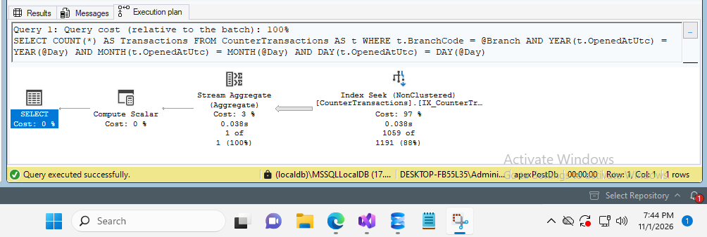
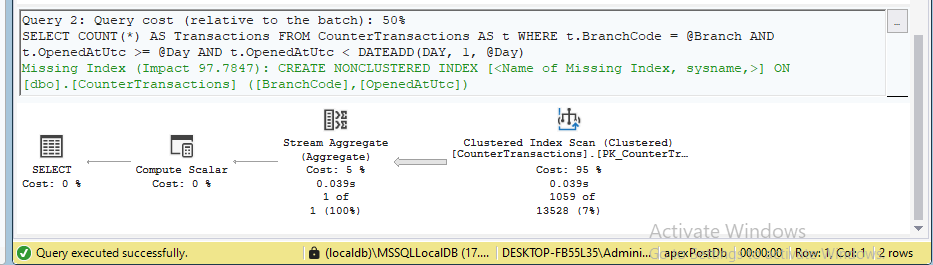


What this shows:

* **A2 is the real non-SARGable case.** A function on the column means SQL Server cannot seek to "the rows of one day". The plan says Index Seek, but the seek only uses `BranchCode`. SQL Server reads all 146 716 index entries of BR001 (955 pages) and tests the three functions on each one. The word "Seek" in a plan does not mean the query is cheap: compare the reads. The fix is B: a range on the bare column, 10 reads, about 95 times fewer than A2.
* **A is a special case.** `CONVERT(date, datetime_column)` is one of the few functions SQL Server can rewrite into a range by itself, so it still seeks (17 reads). Its row estimate, however, was 1 row against 1 059 actual rows both before and after the index, because the optimiser cannot use the histogram for the converted value. B's estimate was in the right region.
* The application and `usp_DailyBranchSales` use form B.

## 6. Estimated versus actual rows (parameter sniffing)

Script 08, section "ESTIMATED vs ACTUAL ROWS". Run on the state **before** the index migration. The plan is compiled for `BR005` (6 714 rows) and then reused for `BR001` (146 716 rows).
The same statement text is sent through `sp_executesql` with different parameter values.

| | Step 1: compiled for BR005 | Step 2: same plan reused for BR001 | Fix: `OPTION (RECOMPILE)` | Fix: `OPTIMIZE FOR UNKNOWN` |
|---|---|---|---|---|
| Estimated rows | 6 592 | 6 592 | 146 556 | 33 374 |
| Actual rows | 6 714 (101 %) | **146 716 (2 225 %)** | 146 716 (100 %) | 146 716 (439 %) |
| Operator | Clustered Index Scan | Clustered Index Scan | Clustered Index Scan | Clustered Index Scan |
| Logical reads | 5 410 | 5 410 | 5 410 | 5 410 |
| CPU / elapsed | 63 ms / 114 ms | 62 ms / 765 ms | 78 ms / 785 ms | 110 ms / 793 ms |
| Compile time | | | 3 ms | |
| Screenshot | `sniff-1.png` | `sniff-2.png` | `sniff-fix-recompile.png` | `sniff-fix-unknown.png` |

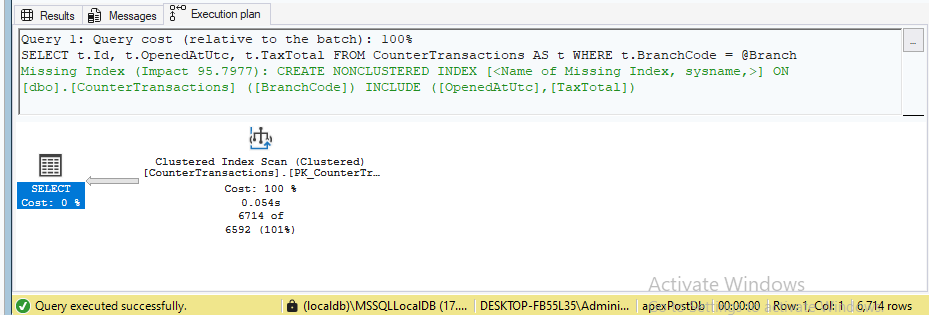
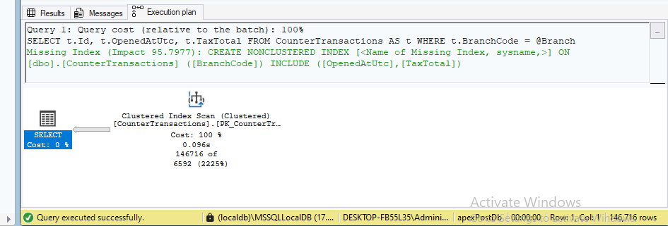
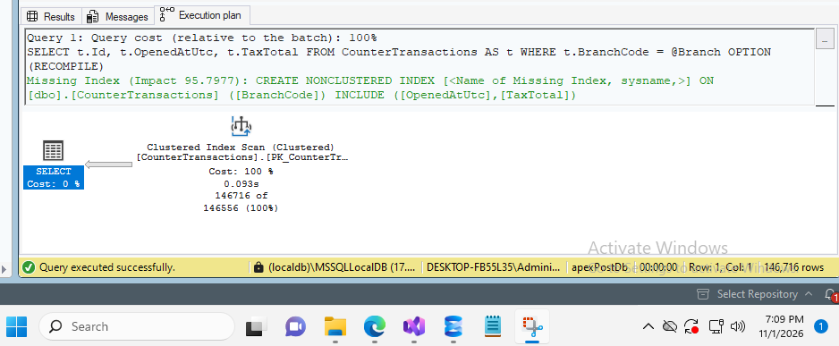
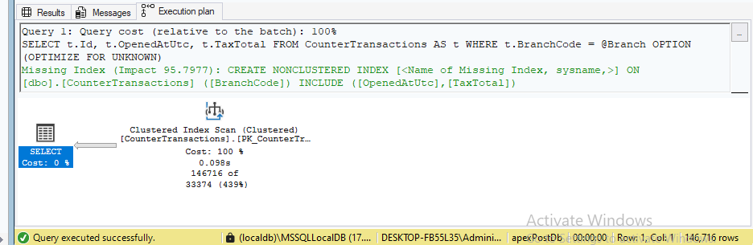

Explanation:

* The optimiser estimates the number of rows from the statistics histogram on `BranchCode`. A plan is cached with the first parameter value it sees. The plan compiled for BR005 estimated 6 592 rows; reused for BR001 it still estimated 6 592 while 146 716 rows came back, 22 times more than expected.
* `OPTION (RECOMPILE)` compiles for every call, so the estimate matches the value (146 556 against 146 716). The price is compile time on each call (3 ms here), which is why it suits rare, heavy reports such as `usp_LowStockReport`.
* `OPTIMIZE FOR UNKNOWN` uses the average density, so the plan is the same for every value: the estimate (33 374) is between the small and the large branch. It is never wrong by a factor of 22, but it is never exactly right either.
* **What did not happen:** the plan operator was a Clustered Index Scan in all four runs, and the reads were 5 410 every time. The classic "seek plus key lookup, then a huge number of lookups" damage did not appear on this data, because even the small branch (6 714 rows, about 3 % of the table) was cheaper to read with a scan than with lookups. So the estimate was wrong by a factor of 22, but the choice of plan did not change and the cost did not change. The wrong estimate would matter when a different plan shape becomes attractive (for example after the index migration, or on a much larger table), because a wrong estimate also gives a wrong memory grant and a wrong join choice.

## 7. EF Core generated SQL (`ToQueryString`)

The integration test `Generated_sql_for_the_main_queries_is_printed_for_the_performance_document` prints the SQL for three queries (copied from its output):

```sql
-- RECENT TRANSACTIONS
DECLARE @p int = 20;

SELECT TOP(@p) [c].[Id], [c].[BranchCode], [c].[ClerkId], [c].[CounterId], [c].[CreatedAtUtc], [c].[CreatedBy], [c].[ModifiedAtUtc], [c].[OpenedAtUtc], [c].[ReversalReason], [c].[RowVersion], [c].[Status], [c].[TaxTotal]
FROM [CounterTransactions] AS [c]
WHERE [c].[BranchCode] = 'BR001'
ORDER BY [c].[OpenedAtUtc] DESC

-- LOW STOCK
SELECT [b].[BranchCode], [b].[Sku], [b].[CreatedAtUtc], [b].[CreatedBy], [b].[ModifiedAtUtc], [b].[Quantity], [b].[RowVersion]
FROM [BranchStock] AS [b]
WHERE [b].[BranchCode] = 'BR001' AND [b].[Quantity] <= 5
ORDER BY [b].[Quantity]

-- TRANSACTIONS WITH LINES (split query)
SELECT [c].[Id], [c].[BranchCode], [c].[ClerkId], [c].[CounterId], [c].[CreatedAtUtc], [c].[CreatedBy], [c].[ModifiedAtUtc], [c].[OpenedAtUtc], [c].[ReversalReason], [c].[RowVersion], [c].[Status], [c].[TaxTotal]
FROM [CounterTransactions] AS [c]
WHERE [c].[BranchCode] = 'BR001'
ORDER BY [c].[Id]
```

(EF Core adds: "This LINQ query is being executed in split-query mode, and the SQL shown is for the first query to be executed." The second query loads the lines.)

| Query | Index it uses (after the migration) |
|---|---|
| Recent transactions | `IX_CounterTransactions_BranchCode_OpenedAtUtc`: equality on `BranchCode`, then the newest rows first, so `TOP(@p)` stops after 20 entries (workload 1). The page size is sent as a parameter (`@p`). |
| Low stock | The primary key `(BranchCode, Sku)` of `BranchStock`: the branch is the first key column, so it is a seek on the branch, then a filter on `Quantity`. |
| Transactions with lines (split query) | `PK_CounterTransactions` plus `IX_CounterTransactions_BranchCode_OpenedAtUtc` for the branch filter. The lines come from a second statement that joins on the primary key `(TransactionId, LineNumber)` of `TransactionLines`, so loading the lines does not cause one query per transaction. |

## 8. No N+1 problem

The test `The_number_of_sql_commands_does_not_depend_on_the_number_of_rows_returned` captures the "Executed DbCommand" log lines of EF Core
(`Microsoft.EntityFrameworkCore.Database.Command`) while loading the newest 3 and then the newest 30 transactions of BR001 with their lines, and asserts that the **number of commands is the same**.
Output of the test (read from the `.trx` result file):

```
3 requested: 3 rows, 2 command(s)
30 requested: 8 rows, 2 command(s)
```

Both calls used 2 SQL commands (one for the transactions, one for their lines: split query), whether 3 or 8 rows came back. An N+1 problem would have used 1 + N commands. The test database holds only 8 transactions for BR001 (the test seed has 40 transactions in total), so "30 requested" returned 8; the test requires the second call to return more rows than the first, so the comparison is valid, but the difference between 3 and 8 rows is small.
Command logging is switched on in `appsettings.Development.json` (`Microsoft.EntityFrameworkCore.Database.Command` at Information), so the SQL of any page can also be read in the console while the app runs.

## 9. Cost of the indexes

Sizes from the last query of script 08 (`sys.dm_db_partition_stats`, used pages x 8 KB).

| Index | Before (KB) | After (KB) |
|---|---|---|
| `CounterTransactions` `IX_CounterTransactions_BranchCode` (dropped, replaced by the two below) | 9 616 | - |
| `CounterTransactions` `IX_CounterTransactions_BranchCode_OpenedAtUtc` | - | 10 408 |
| `CounterTransactions` `IX_CounterTransactions_BranchCode_Status_OpenedAtUtc` | - | 10 416 |
| `TransactionLines` `IX_TransactionLines_LineType_Sku` | - | 17 680 |
| `AuditEntries` `IX_AuditEntries_TimestampUtc` | - | 3 008 |
| **New indexes in total** | | **41 512** |
| **Net growth (new minus the dropped one)** | | **31 896 KB (about 31 MB)** |

For comparison, the table data itself is `PK_CounterTransactions` 43 280 KB, `PK_TransactionLines` 65 392 KB and `PK_AuditEntries` 22 728 KB, so the net growth is about 24 % of these three tables.
Every insert into `CounterTransactions` now maintains three secondary indexes plus the primary key instead of two, and every insert into `TransactionLines` and `AuditEntries` maintains one more.
A counter system reads the lists, reports and audit page far more often than it inserts, so the trade is good here. If the insert rate grew a lot (for example bulk imports), I would watch insert time and the number of page splits, and I would drop `IX_CounterTransactions_BranchCode_Status_OpenedAtUtc` first, because it mostly helps one report that already runs as a stored procedure.

## 10. Test data used for the measurements

The extra rows from script 09 are tagged `CreatedBy = 'perf-load'`. [sql/10_perf_cleanup.sql](sql/10_perf_cleanup.sql) removes only those rows, so the demo database can be returned to its seeded size (240 transactions).
